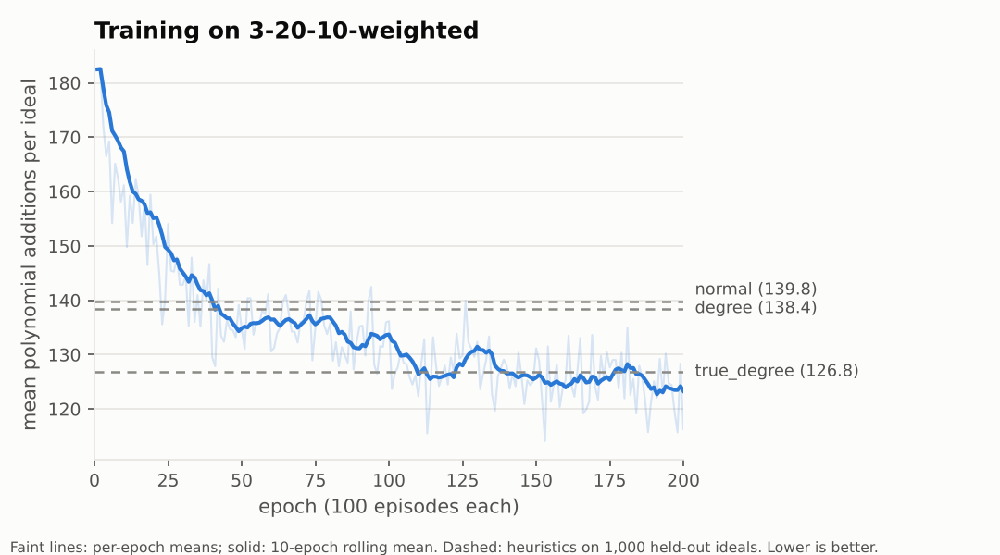
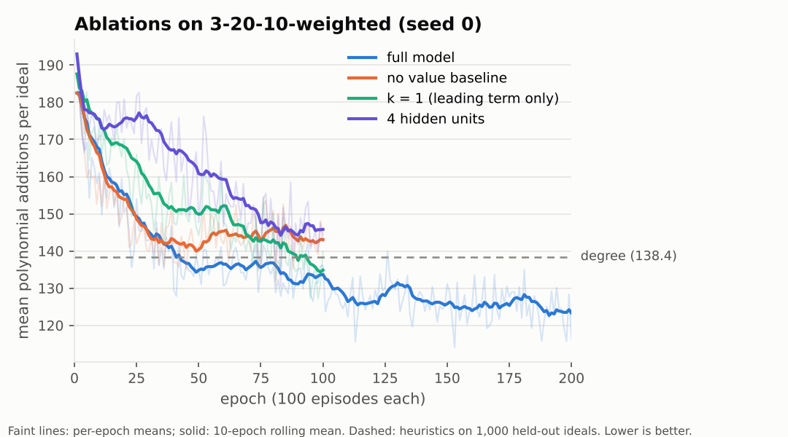
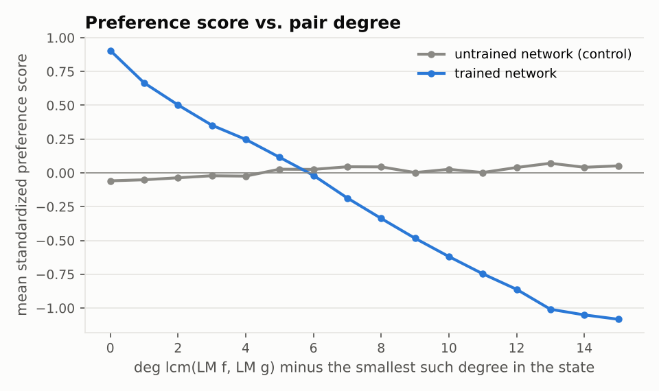

# Learning S-Pair Selection in Buchberger's Algorithm

**Reinforcement learning for a core decision in computer algebra.**
A from-scratch implementation of Buchberger's algorithm over finite fields, a
Markov-decision-process formulation of its S-pair selection step, and a
policy-gradient agent (PPO) that learns which pair to process next. On held-out
random binomial ideals, the learned strategy needs **13.2% fewer polynomial
additions** than the best classical heuristic, and also beats a look-ahead rule
that the classical heuristics cannot match.

<p align="center">
  
</p>

> B.Sc. thesis project in Mathematics and Applications, Isfahan University of
> Technology (2024), supervised by Dr. Amir Hashemi. The thesis (in Persian)
> developed the theory of Gröbner bases and reinforcement learning and studied the
> approach of Peifer, Stillman & Halpern-Leistner (ICML 2020). This repository is
> a complete re-implementation and experimental study built afterwards; **every
> number reported below was produced by the code in this repository** and can be
> regenerated with [`reproduce.sh`](reproduce.sh).

---

## The question

Gröbner bases are the workhorse of computational commutative algebra: they
decide ideal membership, eliminate variables, and solve polynomial systems, with
applications from robotics and cryptography to algebraic statistics.
Buchberger's algorithm computes them by repeatedly choosing a pair of
polynomials, forming their S-polynomial, and reducing it. *Which* pair is
chosen does not affect correctness, but it can change the cost dramatically.
Every computer algebra system fixes this choice with a hand-designed rule
(normal, degree, sugar), tuned by intuition on small benchmark sets.

**Can a strategy learned from data beat these rules on a given distribution
of problems, and what does it learn?**

## Approach

| | |
|---|---|
| **State** | current generating set and pair set $(G_t, P_t)$ |
| **Action** | one pair from $P_t$; the action set changes size at every step |
| **Transition** | deterministic: reduce the S-polynomial and update with the Gebauer–Möller criteria |
| **Reward** | minus the number of polynomial additions spent; with γ = 1 the return is minus the total cost |
| **Observation** | each pair is encoded by the exponent vectors of the two leading terms of both polynomials (12 numbers for 3 variables) |
| **Policy** | one shared MLP (12 → 128 → 1) scores every pair; a softmax over the current pairs gives π(a \| s) |
| **Training** | PPO with clipped surrogate, GAE (γ = 0.99, λ = 0.97), KL early stopping, and a degree-strategy rollout as value baseline |

Sharing one scoring network across pairs makes the policy permutation-
equivariant and independent of the number of pairs, which is what a dynamic
action space requires. It also means a trained model drops straight into an
existing implementation as a sort key on the pair queue.

The cost measure, polynomial additions, is deterministic and hardware-
independent, so results are exactly reproducible and reflect the selection
decisions alone. A detailed derivation, including the explicit PPO gradient for
ragged batches, is in [`docs/background.md`](docs/background.md).

## Results

All numbers come from **1,000 held-out ideals** drawn with a seed disjoint from
training. Every method sees the same ideals, so comparisons are *paired*. The
reference is the best of the four classical strategies. CIs are 95% bootstrap
intervals for the mean number of additions saved per ideal; *p*-values come from a
two-sided Wilcoxon signed-rank test.

### Main result: 3 variables, degree ≤ 20, 10 binomial generators (`3-20-10-weighted`)

| Strategy | Mean additions ± SD | vs. best classical | Additions saved per ideal (95% CI) | *p* |
|---|---:|---:|---:|---:|
| Random | 180.0 ± 68.7 | −30.0% | | |
| First (FIFO) | 176.7 ± 66.5 | −27.6% | | |
| Sugar | 156.4 ± 56.8 | −13.0% | | |
| Normal | 139.8 ± 48.7 | −1.0% | | |
| **Degree** (best classical) | 138.4 ± 48.6 | — | — | — |
| True degree *(look-ahead)* | 126.8 ± 44.0 | +8.4% | 11.6 (9.1 – 14.2) | 1·10⁻²¹ |
| **Learned agent (greedy)** | **120.2 ± 42.1** | **+13.2%** | **18.3 (15.2 – 21.5)** | **4·10⁻²⁹** |
| Learned agent (sampled) | 121.6 ± 45.7 | +12.2% | 16.9 (13.6 – 20.1) | 6·10⁻²⁶ |

* The agent is cheaper than the degree strategy on 64% of ideals and more
  expensive on 34%. It also lowers the spread of the cost by 13% (SD 48.6 → 42.1).
* It beats the **true-degree** rule by 6.7 additions per ideal (95% CI 3.7–9.6,
  *p* = 1·10⁻⁶). True degree is a look-ahead heuristic that computes every
  candidate S-polynomial before choosing; the agent decides from leading
  exponents alone.
* Training used 20,000 episodes (200 epochs × 100), about 25 minutes on two CPU
  cores. The curve above has not yet plateaued.

### Generalisation to other distributions

The same agent, trained only on `3-20-10-weighted`, evaluated without retraining:

| Test distribution | Degree | True degree | Agent (greedy) | Agent vs. degree |
|---|---:|---:|---:|---:|
| `3-20-10-weighted` (training distribution) | 138.4 | 126.8 | **120.2** | **+13.2%** (*p* = 4·10⁻²⁹) |
| `3-20-4-weighted` (4 generators instead of 10) | 155.3 | 144.9 | **137.7** | **+11.3%** (*p* = 1·10⁻²³) |
| `3-20-10-uniform` (degrees skewed towards 20) | 190.8 | **178.2** | 189.4 | +0.7% (*p* = 0.20, n.s.) |

The strategy transfers across the number of generators but **not** to a
distribution dominated by high-degree monomials. There, the inputs fall outside
the range seen in training, and the agent does no better than the degree rule.
Training on a mixture of distributions, or using degree-normalised features, are
the obvious remedies.

### Ablations

Each variant changes exactly one setting and is compared after the same 100
training epochs (main run at epoch 100 for reference):

| Variant | Seeds | Mean additions, greedy (per seed) | vs. degree (138.4) |
|---|:---:|---:|---:|
| Full model (k = 2, 128 hidden units, rollout baseline) | 0, 1 | 127.3 / 127.7 | +8.1% / +7.8% |
| No value baseline (V = 0) | 0 | 143.0 | −3.3% |
| 4 hidden units instead of 128 | 0 | 134.2 | +3.1% |
| k = 1: leading term only (6 features per pair) | 0, 1 | **122.9 / 122.2** | **+11.3% / +11.7%** |

<p align="center">
  
</p>

* **The value baseline is essential.** Without it the agent learns, but after
  100 epochs it is still worse than the degree heuristic. The degree-strategy
  rollout gives low-variance advantages from the first epoch, which matters
  because ideal difficulty varies by an order of magnitude within one
  distribution.
* **Capacity matters.** Four hidden units are enough to beat the heuristic, but
  only narrowly.
* **A surprise: the second leading term does not help, at least at this
  budget.** The leading-term-only agent is *better* under greedy evaluation, by
  5.0 additions per ideal (95% CI 2.8–7.3, *p* = 4·10⁻⁵, pooled over two seeds
  on the same 1,000 ideals). Under sampled evaluation the two are
  indistinguishable (−1.9, CI −4.3 to 0.5). This runs against the observation
  of Peifer et al. that restricting the agent to leading terms hurts
  performance. Plausible explanations are a training budget too short for the
  larger input to pay off, and the dominance of lcm-degree information, which
  the leading terms already contain. Separating these requires longer runs.

### What did the agent learn?

<p align="center">
  
</p>

Over 14,153 states visited on held-out ideals, the agent's preference scores
show a clear structure that the untrained network (same initialisation) lacks:

| Spearman correlation of score with… | Trained | Untrained |
|---|---:|---:|
| degree of lcm(LM f, LM g), i.e. what the degree rule minimises | **−0.67** | 0.04 |
| degree of LM(S(f, g)), i.e. what the true-degree rule minimises | **−0.70** | 0.01 |
| S(f, g) is a single term | **+0.39** | −0.00 |

The agent has rediscovered the degree heuristic and refined it. It prefers
pairs whose S-polynomial has low degree, and pairs whose S-polynomial is a
monomial. Neither preference appears in any of the classical rules. Yet its
choice coincides with the degree rule in only 53% of states and with true degree
in 47%, and it outperforms both. Its strategy is therefore not reducible to
either one. Turning the first insight into a hand-written rule (true degree)
already gives an interpretable heuristic that beats the best classical strategy
by 8.4%.

### Classical strategies across distributions

[`results/strategies/strategies.md`](results/strategies/strategies.md) benchmarks all
seven hand-designed strategies on four distributions (1,000 ideals each). Two
observations stand out. First, sugar, a standard choice in computer algebra systems, is the
weakest informed strategy on these non-homogeneous binomial ideals. Second, on
`3-10-10-maximum`, where both terms of every generator have the same degree,
sugar and normal coincide exactly, as theory predicts for homogeneous input.

## Engineering

* **One algorithm, two drivers.** Buchberger's algorithm is a steppable state
  machine ([`algebra/buchberger.py`](src/buchberger_rl/algebra/buchberger.py)).
  The same code runs the classical strategies and the RL environment, so any
  cost difference is due to the selection decisions alone. A test checks that
  replaying a heuristic inside the environment reproduces its cost exactly.
* **Correctness by invariant.** The reduced Gröbner basis is unique, so the
  tests require *all seven strategies × three pair-elimination schemes* to
  return identical reduced bases on random ideals. Each basis is also checked
  against Buchberger's criterion, and textbook examples are checked against
  their known answers. An independent cross-check against SymPy runs when it
  is installed.
* **PPO in NumPy, with verified gradients.** The policy network, the clipped
  surrogate gradient (including the clipped branch and an entropy bonus) and
  Adam are written out explicitly. Every analytic gradient is checked against
  central finite differences
  ([`tests/test_gradients.py`](tests/test_gradients.py)).
* **Ragged batches without padding.** States have different numbers of pairs.
  Minibatches are stored as one concatenated matrix with segment offsets, and
  per-state softmaxes use `reduceat`, so no masking is needed.
* **Statistics, not anecdotes.** Evaluation is paired on held-out ideals with
  bootstrap CIs and signed-rank tests
  ([`evaluation.py`](src/buchberger_rl/evaluation.py)).
* **Reproducible.** Seeded data generation, YAML configs with command-line
  overrides, CSV training logs, and checkpoints. A single script regenerates
  every table and figure.

## Quick start

```bash
git clone https://github.com/<SetareGhafouri>/buchberger-rl.git
cd buchberger-rl
pip install -e ".[dev]"            # numpy, scipy, pyyaml, matplotlib (+ pytest, sympy)

python -m pytest                   # or: python -m unittest discover -s tests
```

Compute a Gröbner basis and compare strategies:

```python
from buchberger_rl.algebra import PolynomialRing, buchberger
from buchberger_rl.strategies import make_strategy

R = PolynomialRing(3, order="grevlex")
F = [R.parse("x^2 - y"), R.parse("x^3 - z")]          # the twisted cubic
for name in ("first", "degree", "sugar"):
    res = buchberger(F, make_strategy(name))
    print(name, res.stats.additions, [str(g) for g in res.basis])
```

Train, evaluate and analyse:

```bash
python scripts/train.py    --config configs/ppo_3-20-10-weighted.yaml
python scripts/evaluate.py --run runs/ppo_3-20-10-weighted --n 1000
python scripts/analyze_policy.py --run runs/ppo_3-20-10-weighted

# any config entry can be overridden from the command line
python scripts/train.py --config configs/ppo_3-20-10-weighted.yaml \
    --set env.distribution=3-20-4-weighted --set run.epochs=300 --out runs/my_run
```

`./reproduce.sh` regenerates every result in this README in about two hours on two CPU cores.

## Repository layout

```
src/buchberger_rl/
├── algebra/
│   ├── monomials.py      monomial orders as sort keys (lex, grlex, grevlex)
│   ├── polynomial.py     immutable sparse polynomials over GF(p), small parser
│   ├── reduction.py      S-polynomials, division with cost counting, interreduction
│   └── buchberger.py     steppable Buchberger state; Gebauer–Möller pair elimination
├── strategies.py         first, random, degree, normal, sugar, true degree, monomial-first
├── ideals.py             random binomial ideal distributions (n-d-s-{uniform,weighted,maximum})
├── env.py                MDP environment, pair featuriser, rollout value baseline
├── agent/
│   ├── network.py        pair-scoring MLP, segment softmax, Adam (NumPy)
│   └── ppo.py            episodes, GAE, ragged batches, PPO loss/gradient, parallel trainer
├── evaluation.py         paired evaluation, bootstrap CIs, Wilcoxon tests
└── config.py             typed experiment configuration (YAML)
configs/                  main experiment and ablations
scripts/                  train, evaluate, benchmark, analyse, plot
tests/                    27 tests: algebra, environment, PPO, finite-difference gradients
results/                  tables and figures reported above
runs/                     trained checkpoints, training logs and per-ideal evaluation outputs
docs/background.md        mathematical background and derivations
```

## Limitations and future work

* **Scale.** Three variables and binomial ideals keep the study tractable. The
  state encoding fixes the number of variables, and a pair is scored without
  seeing the other pairs. A set- or graph-based encoder (attention over the pair
  set, or a graph neural network on the basis/pair structure) would remove both
  restrictions and is the most promising next step.
* **Generalisation.** The agent does not transfer to high-degree distributions
  (see above). Mixed-distribution training and degree-normalised features should
  be tested.
* **Cost model vs. wall-clock time.** Additions are a faithful,
  hardware-independent proxy, but the agent's inference cost is not counted.
  Integrating the scorer as a sort key into a production system such as
  Macaulay2 or Singular is needed to measure real speed-ups.
* **Compute and seeds.** Training was deliberately small (20,000 episodes on two
  CPU cores). Peifer et al. report larger gains with substantially longer
  training, and the training curve here was still improving when it stopped.
  The 200-epoch main run uses one seed. A second seed reproduces its 100-epoch
  checkpoint to within half an addition, but more seeds would tighten every
  comparison.

## References

* D. Peifer, M. Stillman, D. Halpern-Leistner. *Learning selection strategies in Buchberger's algorithm.* ICML 2020.
* B. Buchberger. *Gröbner bases: an algorithmic method in polynomial ideal theory.* 1985.
* R. Gebauer, H. M. Möller. *On an installation of Buchberger's algorithm.* J. Symbolic Comput., 1988.
* A. Giovini, T. Mora, G. Niesi, L. Robbiano, C. Traverso. *"One sugar cube, please" or selection strategies in the Buchberger algorithm.* ISSAC 1991.
* J. Schulman et al. *Proximal policy optimization algorithms.* 2017; *High-dimensional continuous control using generalized advantage estimation.* ICLR 2016.
* D. Cox, J. Little, D. O'Shea. *Ideals, Varieties, and Algorithms.* 4th ed., Springer, 2015.

A fuller bibliography is in [`docs/background.md`](docs/background.md).

## Citation

```bibtex
@misc{ghafouri2024buchbergerrl,
  author = {Ghafouri, Setare},
  title  = {Learning S-Pair Selection in Buchberger's Algorithm},
  note   = {B.Sc. thesis project, Isfahan University of Technology. Supervisor: A. Hashemi},
  year   = {2024},
  url    = {https://github.com/<SetareGhafouri>/buchberger-rl}
}
```

## Acknowledgements

I thank my supervisor, Dr. Amir Hashemi, for introducing me to computational
algebraic geometry and for his guidance throughout this project.

Released under the [MIT License](LICENSE).
